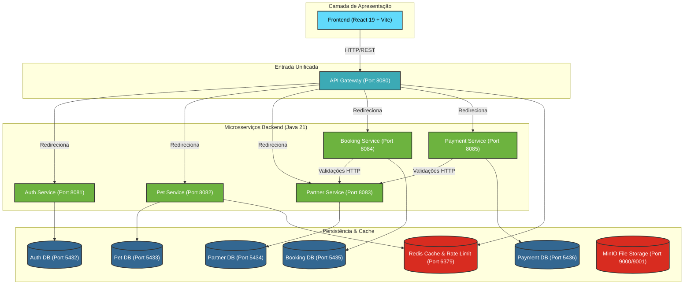

# 🐾 EasyPet — Monorepo da Plataforma

Seja bem-vindo ao monorepo oficial do **EasyPet**, uma plataforma completa de gestão de cuidados e bem-estar pet. O ecossistema conecta tutores de pets a estabelecimentos parceiros (clínicas veterinárias, petshops, hotéis e banho & tosa), oferecendo agendamento online, prontuário eletrônico unificado e um painel de gestão financeira e operacional completo para os parceiros.

Este repositório foi unificado em um monorepo para facilitar o desenvolvimento local, controle de versão e deploy unificado de todos os microsserviços do ecossistema.

---

## 🏗️ Arquitetura do Sistema

O EasyPet é baseado em uma arquitetura de microsserviços robusta e reativa, onde cada serviço possui seu próprio banco de dados isolado para garantir alta coesão e baixo acoplamento:



---

## 📁 Estrutura do Monorepo

O repositório está organizado de forma clara e intuitiva:

```text
Easypet/
├── Backend/
│   ├── Auth-Service/       # Autenticação JWT, Registro de Contas & Google OAuth2 (Spring Boot / Maven)
│   ├── Booking-Service/    # Ciclo de vida dos agendamentos e analytics (Spring Boot / Gradle)
│   ├── Gateway-Service/    # Roteador principal, validação centralizada de JWT & Rate Limiting (Spring Cloud Gateway)
│   ├── Infra/              # Docker Compose da infra local e documentação de arquitetura
│   ├── Partner-Service/    # Gestão de estabelecimentos, horários, profissionais e agendas (Spring Boot / Gradle)
│   ├── Payment-Service/    # Templates e compras de pacotes de créditos pré-pagos (Spring Boot / Gradle)
│   └── Pet-Service/        # Gestão de Pets, prontuários de vacinas, pesos e cirurgias (Spring Boot / Gradle)
├── Frontend/               # Interface Web responsiva dos Tutores e Parceiros (React 19 + Vite + Tailwind CSS v4)
└── start-all.ps1           # Script PowerShell para inicializar toda a aplicação localmente
```

---

## ⚡ Portas e Serviços

### Microsserviços e Aplicações

| Serviço | Porta | Linguagem/Framework | Descrição |
| :--- | :--- | :--- | :--- |
| **API Gateway** | `8080` | Java 21 / Spring Cloud Gateway | Ponto de entrada único e centralizador de requisições. |
| **Auth Service** | `8081` | Java 21 / Spring Boot | Gerenciamento de credenciais, perfis (`ADMIN`, `PARTNER`, `CUSTOMER`), JWT e login social. |
| **Pet Service** | `8082` | Java 21 / Spring Boot | Prontuário médico de pets (consultas, exames, vacinas, cirurgias). |
| **Partner Service** | `8083` | Java 21 / Spring Boot | Marketplace público de estabelecimentos, cadastro de profissionais e agendas. |
| **Booking Service** | `8084` | Java 21 / Spring Boot | Agendamentos de serviços simples ou pacotes e analytics de faturamento. |
| **Payment Service** | `8085` | Java 21 / Spring Boot | Compra e controle de consumo de créditos e pacotes de serviços. |
| **Frontend** | `5173` | TypeScript / React 19 + Vite | Painel dos parceiros, landing page e área de agendamento do tutor. |

### Infraestrutura Local (Docker Compose)

| Serviço | Porta Exposta | Descrição |
| :--- | :--- | :--- |
| **auth-db** | `5432` | Banco PostgreSQL para dados de usuários e autenticação. |
| **pet-db** | `5433` | Banco PostgreSQL para dados de pets e prontuários médicos. |
| **partner-db** | `5434` | Banco PostgreSQL para estabelecimentos parceiros e profissionais. |
| **booking-db** | `5435` | Banco PostgreSQL para ciclo de vida de agendamentos. |
| **payment-db** | `5436` | Banco PostgreSQL para controle de compras e consumo de pacotes. |
| **Redis** | `6379` | Cache e controle de requisições por segundo (Rate Limiting). |
| **MinIO Console** | `9001` (API: `9000`) | Armazenamento de arquivos estáticos local (S3-compatible). |
| **PgAdmin** | `5050` | Gerenciador visual unificado para todos os bancos PostgreSQL. |

---

## 🚀 Como Executar o Projeto Localmente

### 1. Pré-requisitos
* **Docker & Docker Compose** instalados.
* **Java SDK 21** instalado e configurado nas variáveis globais.
* **Maven 3.9+** e **Gradle 8+** (ou use os wrappers incluídos em cada pasta).
* **Node.js 20+** e gerenciador de pacotes `npm`.
* **Windows Terminal** (altamente recomendado para executar o script de inicialização automática).

### 2. Configurando as Variáveis de Ambiente (`.env`)
Certifique-se de que cada microsserviço contenha seu respectivo arquivo `.env` configurado. Os arquivos locais já foram gerados com as credenciais padrão do Docker Compose:

* O `JWT_SECRET` é compartilhado e **idêntico** em todos os microsserviços (`sua_chave_secreta_compartilhada_easypet_2026`) para que o Gateway e demais serviços validem os tokens gerados pelo Auth Service.
* Caso precise usar integrações como Google OAuth2 ou SMTP de e-mails, edite o arquivo `Backend/Auth-Service/.env` com as suas credenciais reais do console Google Cloud e servidor de e-mail.

---

### 3. Execução

#### Opção A: Execução Automática (Recomendada no Windows)
Na pasta raiz do monorepo (`C:\Projects\Easypet`), abra o PowerShell e execute:
```powershell
.\start-all.ps1
```
Este script inicializa automaticamente os containers da infraestrutura e em seguida abre abas específicas no **Windows Terminal** executando a compilação e inicialização de cada microsserviço e do frontend.

#### Opção B: Execução Manual
Se preferir ou estiver em outro sistema operacional, execute os serviços seguindo estes passos:

1. **Subir a Infraestrutura:**
   ```bash
   cd Backend/Infra
   docker compose up -d
   ```
2. **Iniciar o Auth Service:**
   ```bash
   cd Backend/Auth-Service
   mvn spring-boot:run
   ```
3. **Iniciar o Gateway Service:**
   ```bash
   cd Backend/Gateway-Service
   mvn spring-boot:run
   ```
4. **Iniciar os Serviços via Gradle (Pet, Partner, Booking e Payment):**
   Abra uma janela de terminal para cada um e execute:
   ```bash
   # Em Backend/Pet-Service
   # Em Backend/Partner-Service
   # Em Backend/Booking-Service
   # Em Backend/Payment-Service
   ./gradlew bootRun
   ```
5. **Iniciar o Frontend:**
   ```bash
   cd Frontend
   npm install
   npm run dev
   ```

Acesse o painel do tutor/parceiro através de `http://localhost:5173`.

---

## Homologação interna

O EasyPet é implantado manualmente na VPS com Git e Docker Compose. O [guia de homologação](Backend/Infra/docs/homologacao.md) cobre a primeira instalação, a atualização e o roteiro de testes.

## 📚 Documentação Adicional

Manuais de arquitetura, segurança e detalhamento técnico podem ser encontrados na pasta de infraestrutura:
* [Arquitetura Geral e Fluxo de Autenticação](file:///C:/Projects/Easypet/Backend/Infra/docs/architecture.md)
* [Serviços e Variáveis Compartilhadas](file:///C:/Projects/Easypet/Backend/Infra/docs/services.md)
* [Guia Detalhado de Getting Started](file:///C:/Projects/Easypet/Backend/Infra/docs/getting-started.md)

---

Desenvolvido e mantido por [Randy Gomes](https://github.com/randygomesdev).
